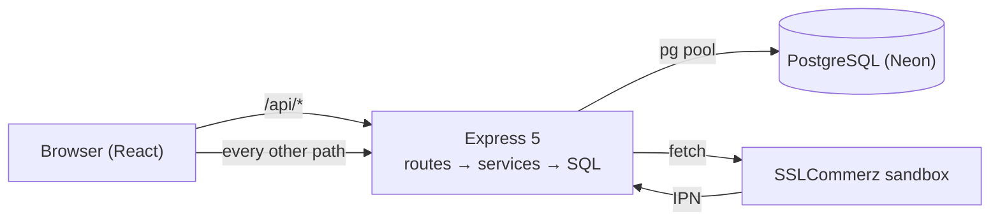

# HomeService

[](https://github.com/sajidur70/homeservice/actions/workflows/ci.yml)

**Book trusted electricians, plumbers, AC technicians and tutors in Dhaka.**
Customers see a provider's real free times, book, pay and review. Providers manage their services and working hours.
An admin approves providers.

**Live demo: https://homeservice-i2bk.onrender.com**

> Free hosting: the server sleeps after ~15 minutes idle, so the first visit can take up to a minute to wake it.

| Role | Email | Password |
|---|---|---|
| Customer | `customer@homeservice.dev` | `password123` |
| Provider | `rahim@homeservice.dev` | `password123` |
| Provider (not approved yet) | `pending@homeservice.dev` | `password123` |
| Admin | `admin@homeservice.dev` | `password123` |

The login page also has one-click demo buttons.

---

## Highlights

The interesting parts are not the CRUD screens but the rules that must hold when many people use the app at once.

1. **No double booking under concurrency.** Two customers clicking "Book" on the same slot at the same millisecond can't
   both win. Booking creation takes a row lock on the provider (`SELECT … FOR UPDATE`), then checks for overlaps, then
   inserts, all in one transaction. A PostgreSQL **exclusion constraint** (`btree_gist`) is the safety net: two paid
   bookings of one provider can never overlap, even if the application code had a bug.
   → [`server/src/services/booking.ts`](server/src/services/booking.ts), [`server/migrations/001_init.sql`](server/migrations/001_init.sql)
2. **A 15-minute payment hold without a cron job.** An unpaid booking blocks its slot only while
   `created_at > now() - 15 minutes`. One shared SQL fragment decides what "blocking" means, so the slot list, booking
   creation and payment confirmation can never disagree.
   → [`server/src/db/fragments.ts`](server/src/db/fragments.ts)
3. **Idempotent payments.** The payment gateway calls back twice (browser redirect + server-to-server IPN), in any order.
   A conditional `UPDATE … WHERE status <> 'PAID'` lets exactly one call confirm; late money after a lost slot is
   cancelled and flagged for refund. Locks are always taken in one order (provider → booking → payment), so no deadlocks.
   → [`server/src/services/payment.ts`](server/src/services/payment.ts)
4. **Timezone-correct slots.** Instants are stored in UTC; working hours are minutes after midnight in Dhaka (UTC+6).
   The slot calculator is a **pure function** (the clock is passed in), covered by 12 unit tests including the
   "05:00 Dhaka is the previous day in UTC" edge case.
   → [`server/src/lib/slots.ts`](server/src/lib/slots.ts), [`server/test/slots.test.ts`](server/test/slots.test.ts)
5. **Ratings without drift.** `rating_sum` and `rating_count` are integers, updated atomically in the same transaction
   as the review insert; the average is computed on read.
   → [`server/src/services/review.ts`](server/src/services/review.ts)

Also: every SQL value goes through `$1` placeholders, ownership checks live in the `WHERE` clause (no IDOR), passwords
use `scrypt` with a random salt and constant-time compare, login is rate-limited, and the server sends a strict CSP.

## Proof: no double booking

[`server/scripts/race.ts`](server/scripts/race.ts) fires **5 booking requests for the same slot at the same moment**.

| Run | 1 | 2 | 3 | 4 | 5 | 6 | 7 | 8 |
|---|---|---|---|---|---|---|---|---|
| **Without** the row lock: bookings created | 2 | 4 | 5 | 4 | 4 | 5 | 5 | 5 |
| **With** the row lock: bookings created | 1 | 1 | 1 | 1 | 1 | | | |

With the lock, every run returns one `201` and four `409 Conflict`, locally and **against the live production site**
(`Status codes: 409, 201, 409, 409, 409`). Without it, all 8 runs double-booked: with the database in Singapore every
query is a network round trip, so the gap between "check" and "insert" is wide enough for all 5 requests.
The same race runs in CI as an integration test.

## Tech stack

| Layer | Choice |
|---|---|
| Language | TypeScript (strict) on server and client |
| Server | Node 24+ running `.ts` directly (type stripping, no build step) · Express 5 · `pg` with plain SQL · zod · jsonwebtoken |
| Database | PostgreSQL on Neon (Singapore) · exclusion constraint (`btree_gist`) · trigram search index (`pg_trgm`) |
| Client | React 19 · React Router · Vite · plain CSS (light/dark theme with a switch) · `fetch` · self-hosted Inter font |
| Tests | `node:test`: 12 unit + 7 integration tests (including the race), against a real PostgreSQL |
| CI / Hosting | GitHub Actions with a Postgres service container · one Render web service serves the API and the React app |

**7 runtime code dependencies** in total (server: `express`, `pg`, `zod`, `jsonwebtoken`; client: `react`, `react-dom`,
`react-router`), plus one font package.

**Deliberately not used:** an ORM, dotenv, cors, helmet, morgan, bcrypt, express-rate-limit, Axios, Tailwind, component
libraries, Redux, Jest. Node has built-in `--env-file`, `--watch`, `crypto.scrypt`, `fetch` and a test runner; the few
security headers, the request log and the rate limiter are ~60 lines of readable middleware; and one origin means no CORS.



## Run it locally

Needs **Node 24+** and a PostgreSQL database (a free [Neon](https://neon.tech) project works; any Postgres 13+ with
`btree_gist` and `pg_trgm` does too).

```powershell
cd server
npm ci
Copy-Item .env.example .env      # then set DATABASE_URL and JWT_SECRET (instructions inside the file)
npm run db:migrate               # creates the 8 tables
npm run db:seed                  # demo data and the accounts above
npm run dev                      # API on http://localhost:5000

# second terminal
cd client
npm ci
npm run dev                      # app on http://localhost:5173 (Vite forwards /api to :5000)
```

`PAYMENT_MODE=mock` (the default) confirms payments instantly. `PAYMENT_MODE=sslcommerz` uses the real SSLCommerz
sandbox with your store id and password.

## Tests

```powershell
cd server
npm run test:setup   # migrate + seed the TEST database (server/.env.test); the tests change data
npm test             # 19 tests: 12 unit + 7 integration (health, auth, search, booking, race, payment, review)
npm run race         # the 5-simultaneous-bookings script against a running API (API_URL to target another host)
```

CI runs the type-check, all 19 tests and the client build on every push, against a throwaway Postgres container.

## Deploy

[`render.yaml`](render.yaml) is a Render Blueprint: one web service in Singapore, next to the database. The root
[`package.json`](package.json) build installs both packages, builds the React app and **runs migrations before the new
version goes live**, so a failing migration fails the deploy and the old version keeps serving. Rollback = Render's
previous deploy, or a Neon branch restored to a point in time.

## What I'd do next

* Automatic refunds through the gateway API instead of an admin list.
* Email/SMS notifications for new bookings and reminders.
* Move the rate limiter's counters to Redis before running more than one server instance.
* Keyset pagination for deep search pages; a `payment_attempts` table to keep the history of failed attempts.
* Refresh tokens in an httpOnly cookie instead of a long-lived token in `localStorage`.
* Several working windows per day (e.g. a lunch break) and more cities/timezones.
